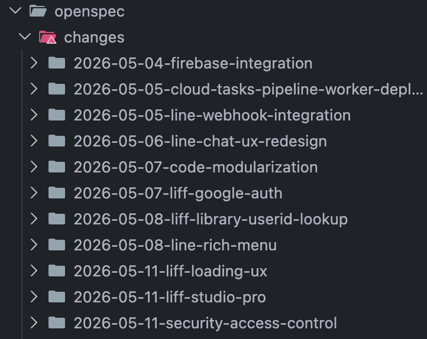
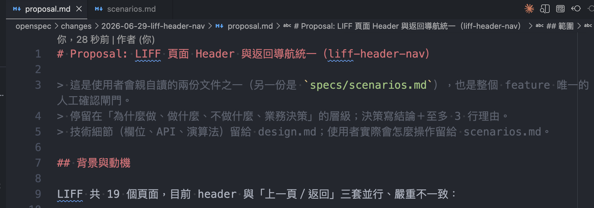
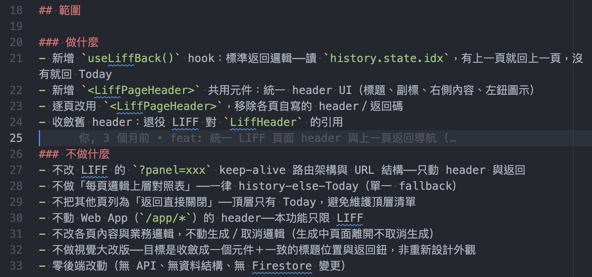
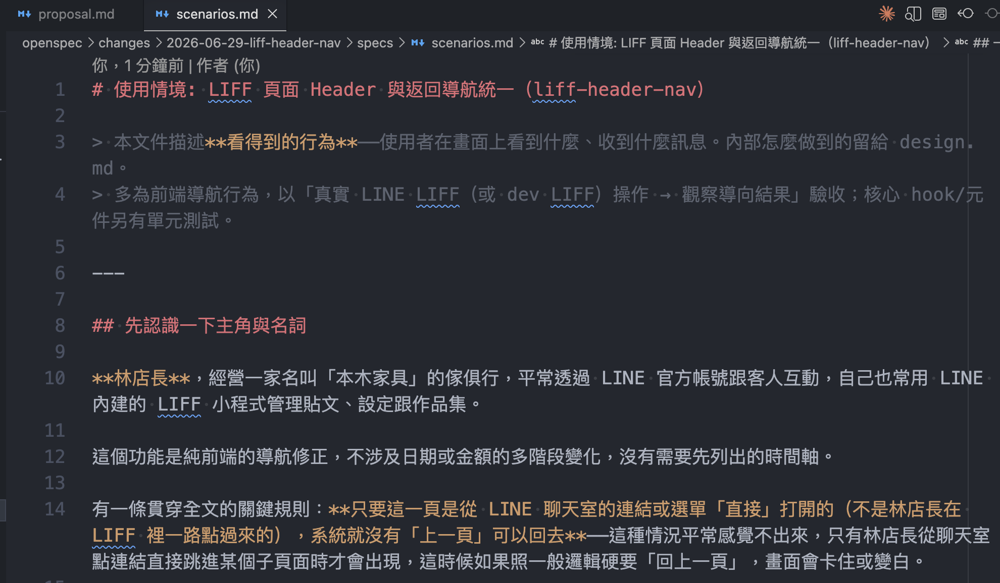
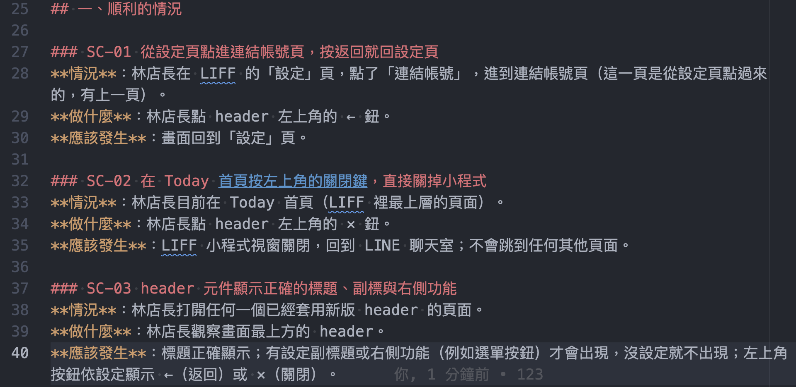
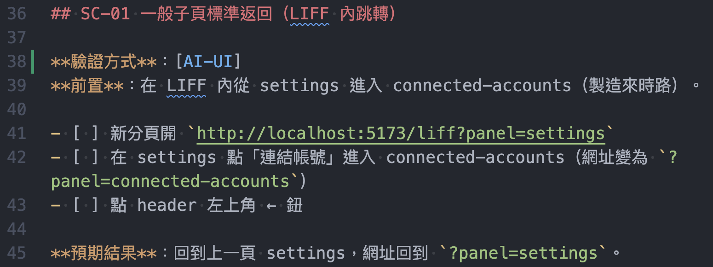

# AI 開發流程 - 規格驅動開發（SDD）框架

目前使用的 AI 輔助開發流程，整合 OpenSpec（規格管理）、Superpowers（強制 TDD 與子代理分工方法論）與自訂 SKILL.md，把「先規格、後實作」變成一條可重複執行的 pipeline。

## Tech Stack
- Claude Code
- OpenSpec（規格文件目錄慣例：proposal / scenarios / design / tasks）
- Superpowers（TDD 方法論、子代理分工框架）
- 自訂 SKILL.md（定義每個 `/sdd-*` 指令的固定工作流程）
- Git Worktree（多功能並行開發隔離）
- Vitest、knip（整合進自動品質閘門）

## Highlights
- 規格先行：任何功能實作前，必須先產出 proposal.md（做什麼/不做什麼）與 scenarios.md（使用者怎麼操作、看得到什麼），經人工確認後才能動工，避免 AI 自行腦補需求
- 強制 TDD：先寫測試（RED）→ 實作（GREEN）→ 重構（REFACTOR），順序顛倒就整段刪除重寫，不接受「先寫完程式再補測試」
- 兩軸自動審查：一軸核對「做的是不是規格要的東西」，另一軸核對「寫得好不好、合不合專案慣例」，兩者分開列出問題，不混成一個總分
- AI 自動驗收：功能完成後由 AI 自己啟動本地環境，直接呼叫 API 或操作瀏覽器跑過所有驗收情境，只有真正需要人工（例如登入）的步驟才交回開發者
- 全流程只留兩個人工停點（需求確認、最終人工驗收），其餘審查、修正、重驗都由 AI 自主完成，不需要逐步盯著下指令
- 多功能可並行開發：用 git worktree 把每個 feature 隔離在獨立工作目錄，互不干擾主分支與其他進行中的工作
- 上雲端/AI API 等有計費風險的功能，規格確認前先做費用估算（低/中/高用量情境），確認成本可接受才繼續，避免上線後才發現費用超支

## Interesting Challenges
- 技術設計文件刻意不找人審查：審一份文件，頂多抓出「前後講的矛不矛盾」，抓不出「這個做法對不對」，因為沒有東西可以拿來對答案。真正能驗證對不對的，是後面兩關——拿實際寫出來的程式碼去對照規格書，以及把功能真的跑起來看會不會動，所以把審查力氣都押在這兩關，中間的設計文件就不浪費時間審了
- 交辦任務給子 AI 時要分清楚什麼該整段貼、什麼只給路徑：子 AI 看不到前面的對話紀錄，等於每次都是空白狀態重新開始。檔案已經存在硬碟上的（規格書、專案設定），就叫子 AI 自己開檔案讀，只有單純聊天聊出來、沒有存成檔案的內容，才需要整段複製貼上。不然的話，等於花好幾倍的費用去複製一份電腦裡本來就有的東西
- 多人同時開發時，先確定「跟最新的主線一起測過」才能合併：假設兩人同時各做一個功能，你的功能是拿「你驗收當下的主線」去測試過的，但如果對方的功能先合併進主線，現在的主線已經變了，你的功能其實從來沒跟「新的主線」一起測試過。所以合併前會先檢查主線有沒有更新，有的話就同步最新版本、重新完整測一次，確定沒問題才真的合併
- 規格跟實際做出來的東西如果有落差，要留紀錄而不是直接改掉：人工驗收時難免會順手修正幾個小地方，這時候跟最初寫的規格書就會有點不一樣。如果直接把規格書改成跟最後結果一樣，以後回頭看會完全看不出「當初想做的」跟「後來實際做的」差在哪裡、為什麼要改。所以不覆蓋原本的規格，而是另外寫一份記錄「新增了什麼、改了什麼、規格原本要但後來沒做」，兩份都留著

## 開發流程

```
/sdd-brainstorm → 需求訪談，產出 proposal.md（提案） + scenarios.md（使用者情境） → 人工確認（唯一文件閘門）
      ↓
/sdd-propose    → AI 自動生成 design.md（技術設計）與 tasks.md（任務清單）（皆不審查）
                  ＋ 同步產出 e2e-test-guide.md（驗收清單）草稿——把每條情境轉成「驗證方式／前置／步驟／預期結果」
      ↓
/sdd-apply      → 逐任務 TDD 實作，分組邊界跑測試把關
      ↓
/sdd-review     → 兩軸審查（規格相符 / 程式碼品質）＋ 自動修正 ＋ 核對並更新 e2e-test-guide.md，對照真實實作修正路徑與驗證方式標記
      ↓
/sdd-verify     → AI 自動驗收：依 e2e-test-guide.md 的標記逐條執行（API 直接呼叫、瀏覽器自動操作），人工只補無法自動化的部分
      ↓
/sdd-merge      → 同步主分支、重驗、生成 delta.md（記錄規格與實作的落差）、squash merge
```

另有 `/sdd-lite` 輕量軌（省去獨立設計文件與審查群組切分，品質閘門保留）供小型功能選用，以及 `/debug`、`/quick-task` 等獨立指令處理除錯與小修改。

## Screenshots

以實際專案裡一個單純的功能（統一 LIFF 頁面的 header 與返回鍵邏輯）為例，展示規格文件實際長什麼樣子：

### 規格資料夾結構
- 每個功能都有自己的資料夾，依日期＋功能名稱命名，裡面裝著 proposal、scenarios、design、tasks 等文件
- 示意用途，實際資料夾還有數十個其他功能的規格紀錄



### proposal.md：背景與動機
- 人工確認的第一份文件，說明為什麼要做這個功能、原本的問題在哪
- 開頭就寫明這是「兩份人讀的文件之一」，也是整個功能唯一的人工確認閘門



### proposal.md：做什麼／不做什麼
- 「不做什麼」跟「做什麼」同樣重要，用來防止範圍一路擴大
- 可以看到左側的 git blame 標註實際開發時間，證明這是真實商業專案裡跑出來的文件，不是為了展示臨時編的



### scenarios.md：具名主角與情境
- 用一個具體的人物設定（林店長）取代「使用者」這種抽象說法，讓每條情境都具體到可以直接拿去寫測試
- 下方逐條列出 SC-01、SC-02、SC-03 等情境，固定用「情況／做什麼／應該發生」三段式描述





### e2e-test-guide.md：對應每條情境的驗收清單
- 每條使用情境都轉成「驗證方式／前置／操作步驟 checklist／預期結果」，標記這條該用瀏覽器操作驗證還是直接呼叫 API 驗證
- 這份文件由 `sdd-propose` 先產出草稿、`sdd-review` 核對修正，最後由 `sdd-verify` 實際照著跑一遍，是連接「規格」跟「AI 自動驗收」中間的橋樑


