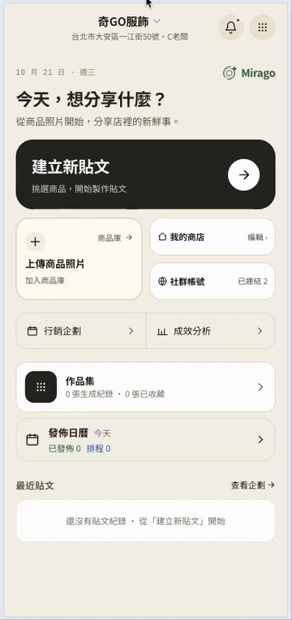
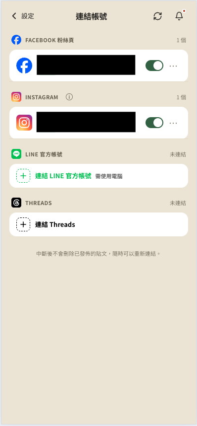
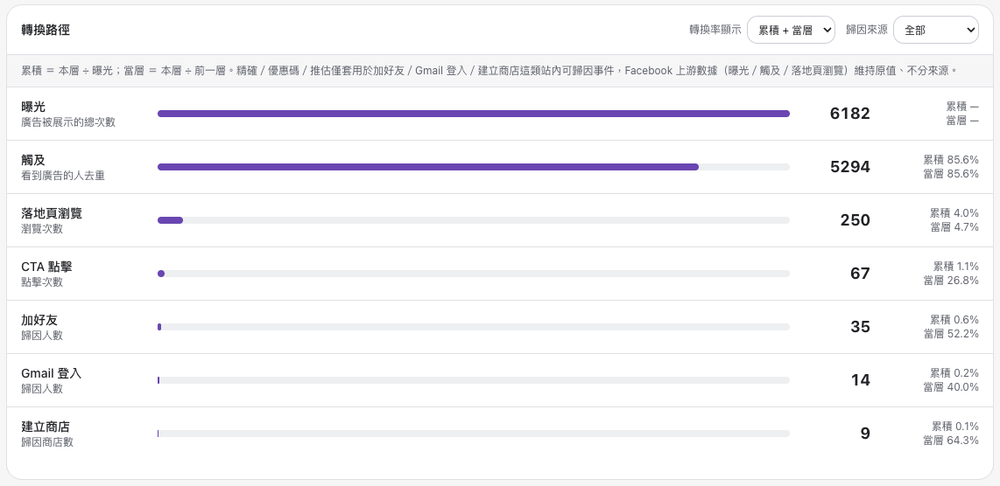
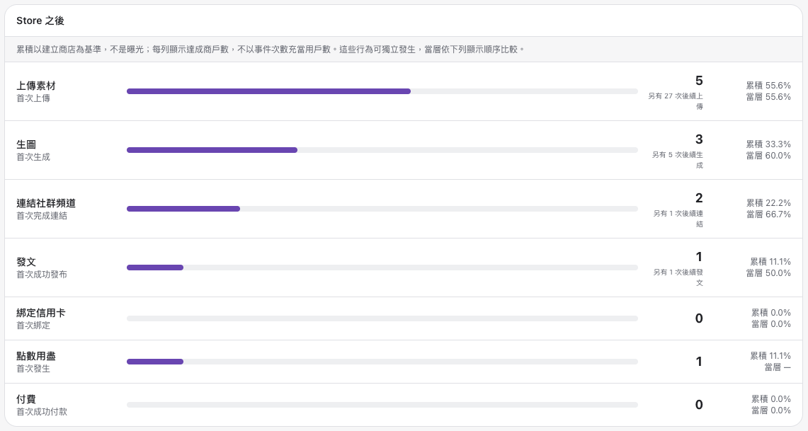

# [Mirago](https://mirago.miraclemobile.ai/lp/) - LINE LIFF Page 行銷平台

協助商家自動產製貼文圖片與發布社群行銷內容的平台，商家透過 LINE 和 Google 登入開啟 LIFF 頁面，就能生成商品行銷圖片與文案，並一鍵發佈到 Facebook、Instagram、Threads 與 LINE OA。

## Tech Stack
- **Frontend:** React 19, React Router 7, Vite, Tailwind CSS, LINE LIFF
- **Backend:** Express 5, Zod, Repository Pattern
- **Database:** Firestore
- **Cloud & DevOps:** Google Cloud Run, Cloud Tasks, Cloud Scheduler, Firebase Hosting
- **第三方整合:** LINE Messaging API、Meta Graph API（Facebook / Instagram / Threads）、Meta Marketing API、Gemini / GPT-image、TapPay（金流）
- **Testing:** Vitest（206+ 測試檔）, knip

## Highlights
- 商家透過 LINE 和 Google 登入開啟 LIFF 頁面操作，點圖即可生成商品行銷圖片與文案，不需另外學習工具
- 一次製作、一鍵發佈到 Facebook、Instagram、Threads、LINE OA 四個平台
- AI 自動提案行銷企劃：依節日檔期、每週主題自動排出多篇貼文與發文時程，商家只需同意或調整
- 貼文成效自動彙整、主動推播提醒（節日提案、未發佈、會員缺資料），降低商家漏發文、漏回覆的情況
- 以點數制計費、站內透過 TapPay 直接購買點數方案

## Interesting Challenges
- 發佈作業不可重複執行：以任務認領機制與確定性識別碼確保冪等，作業結束後進行狀態核對
- 長時間背景作業的狀態呈現：跨多階段的進度、失敗與完成回饋，並處理使用者中途離開後回訪
- 多租戶資料隔離：定義單一的擁有權判定來源，所有資料查詢一律以該來源為依據
- 多平台差異吸收：四個社群平台的授權模式、內容格式與發佈限制皆不同，需在共用流程下吸收差異
- Firestore TTL 靜默失效：TTL 欄位型別錯誤時 Firestore 不會報錯、政策狀態也照樣顯示 ACTIVE，需額外撰寫健檢腳本才能主動偵測

## Demo

### AI 生成行銷圖片與文案
- 從商品庫選商品、自訂角色／姿勢／場景／風格／光線，AI 構思貼文目標與 Hook / Value / CTA
- 生成完成後直接套進 FB、IG、Threads、LINE 各平台版位，顯示已選張數與啟用狀態，準備進入發佈流程

### 連結社群帳號
- 商家可在設定頁連結 Facebook 粉絲頁、Instagram、LINE 官方帳號、Threads，一次管理所有發佈通路
- 中斷連結不會刪除已發佈的貼文，可隨時重新連結

### 廣告轉換路徑漏斗
- 自建轉換漏斗追蹤：從廣告曝光、觸及、落地頁瀏覽、CTA 點擊，到加好友、Gmail 登入、建立商店，逐層計算累積與當層轉換率
- 補充 Meta 的歸因數據，作為判斷廣告成效的依據

- 商家建立商店後的後續行為追蹤：上傳素材、生圖、連結社群頻道、發文、綁定信用卡、點數用盡、付費
- 以建立商店數為基準，呈現每個階段的累積與當層轉換率，協助找出商家流失的環節

